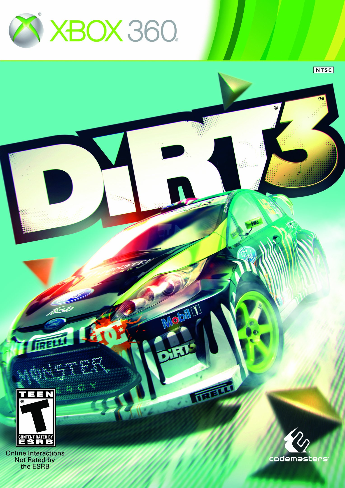
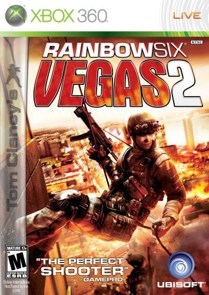
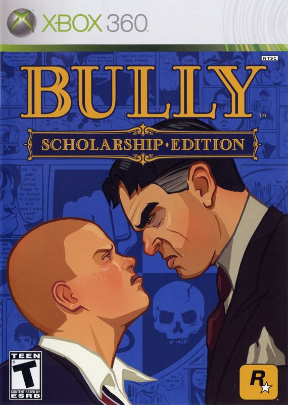
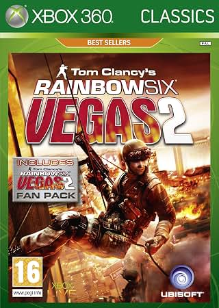

# Xbox 360 Unlocked FPS — Modified XEXs

Modified Xbox 360 executables for RGH/JTAG consoles, grouped by game in GitHub Releases.

## Downloads

Open **Releases** and choose your game. Each game release provides its modified XEX variants as separate downloads, plus any required update-data files, instructions, and SHA-256 hashes.

Match the release's Title ID, Media ID, executable version, and title-update requirements to your game before replacing files.

| Game | Title ID | Media ID in the supplied examples |
| --- | --- | --- |
| Rainbow Six Vegas 2 | `55530807` | `1982EE1E` |
| Bully: Scholarship Edition | `5454081A` | `0867AD86` |
| DiRT 3, original release | `434D083D` | `75036F79` |

| Rainbow Six Vegas 2, Complete Edition Europe / Streets variant | `55530807` | `47D7F6C0` |

Other releases or updates may require different files.

**Bully is not GOD-friendly: do not convert the modified Bully files to GOD. Use the complete extracted game folder.** This exception applies to both conversion methods below.

DiRT 3: download `Dirt3_TU_FPS_variants.zip` and **try the A variant first**. Put its matching `patch.nfs` beside the selected executable, renamed `default.xex`, in the complete extracted game folder. See the DiRT 3 release for full instructions.

[RSV2 Complete Edition Europe release](https://github.com/TabbyEgg/Xbox360-Unlocked-FPS-Modified-XEXs-/releases/tag/rsv2-complete-europe-streets-1): the Streets/intro-skip variant is separate from the older Media ID `1982EE1E` builds. The contributor reports Streets access and startup reduced from about 32 to 21 seconds; the dark CQC Training variant is laggy.

## Extract an ISO to get the XEX

1. Back up your original game files and `default.xex`.
2. If your source is an ISO, use **ISO to XEX** to extract the **complete game folder**. Keep all game files and subfolders together.
3. Locate `default.xex` in the extracted folder.
4. Download the modified XEX matching that game's build and update state.
5. Follow the release instructions. You can launch a separately named XEX through Neighborhood or a console file manager. For normal dashboard scanning, preserve the original under a backup name and name the selected modified executable `default.xex`.
6. Keep required update assets in the location stated by that release. For the DiRT 3 game-folder candidates, the matching `patch.nfs` belongs beside the XEX.
7. Test the complete extracted game through Neighborhood or your usual launcher before converting it to GOD.

A loose XEX contains executable code; the complete extracted game folder supplies the rest of the game.

## Convert the modified game to GOD

### ISO2GOD Next: convert the extracted/XEX folder directly

**Complete extracted game folder with the modified `default.xex` → ISO2GOD Next's XEX-folder option → GOD**

1. Start with the complete extracted game folder that works on your console, including any required update assets.
2. Ensure the chosen modified executable is named `default.xex`.
3. In **ISO2GOD Next**, choose the **XEX-folder** input option and select that complete game folder.
4. Convert directly to GOD. No ISO rebuilding step is needed for this method.

### Older ISO2GOD versions: use a rebuilt ISO

**Complete modified game folder → rebuilt Xbox 360 ISO → ISO2GOD → GOD**

1. Start with the same complete, working modified game folder.
2. Use an Xbox 360 ISO rebuilding tool to create an ISO from that folder.
3. Open the rebuilt ISO in an older **ISO2GOD** version that requires ISO input and convert it to GOD.

For either method, transfer the generated GOD package and its matching data folder to the console, preserving their names and directory structure. Refresh the dashboard's game scan and test the converted installation.

## Variants and console testing

The collection includes examples with console-test results reported by the contributor. Each release should identify the game build, selected variant, and observed console behavior; measured FPS is stated only when measurements are available.

- **Unlocked** variants remove the documented frame-rate/presentation restriction and can introduce screen tearing.
- **V-sync** variants, where supplied and explained for that game, use synchronized presentation. Performance still depends on the scene and console workload.
- **Original/base-game** and **TU-merged** variants have different update requirements. Follow the individual release instructions.

Observed results apply to the tested build and setup.

## Files by game

The tables describe file contents and intended presentation behavior. A 60 Hz presentation ceiling does not guarantee sustained 60 FPS. Console observations are recorded in the individual releases.

### DiRT 3 — original release

[Open release and downloads](https://github.com/TabbyEgg/Xbox360-Unlocked-FPS-Modified-XEXs-/releases/tag/dirt3-tu-gamefolder-test-1) · Title ID `434D083D` · Media ID `75036F79`

| Asset | Build | Presentation behavior / purpose |
| --- | --- | --- |
| [Dirt3_TU_vsync60_A.xex](https://github.com/TabbyEgg/Xbox360-Unlocked-FPS-Modified-XEXs-/releases/download/dirt3-tu-gamefolder-test-1/Dirt3_TU_vsync60_A.xex) | TU v0.0.1.3 | **Try first.** VSync plus the guide’s second NOP edit; possible limiter effect. |
| [Dirt3_TU_vsync60.xex](https://github.com/TabbyEgg/Xbox360-Unlocked-FPS-Modified-XEXs-/releases/download/dirt3-tu-gamefolder-test-1/Dirt3_TU_vsync60.xex) | TU v0.0.1.3; derived comparison | VSync; A’s second guide edit restored to its original instruction. |
| [Dirt3_TU_unlocked_gamefolder.xex](https://github.com/TabbyEgg/Xbox360-Unlocked-FPS-Modified-XEXs-/releases/download/dirt3-tu-gamefolder-test-1/Dirt3_TU_unlocked_gamefolder.xex) | TU v0.0.1.3 | Unlocked presentation; tearing can occur. |
| [Dirt3_TU_clean_gamefolder_control.xex](https://github.com/TabbyEgg/Xbox360-Unlocked-FPS-Modified-XEXs-/releases/download/dirt3-tu-gamefolder-test-1/Dirt3_TU_clean_gamefolder_control.xex) | TU v0.0.1.3 | Clean control with local update-data lookup; no FPS edits. |
| [patch.nfs](https://github.com/TabbyEgg/Xbox360-Unlocked-FPS-Modified-XEXs-/releases/download/dirt3-tu-gamefolder-test-1/patch.nfs) | Matching original-release TU data | Required beside the chosen XEX; included in the variants ZIP. |

**Use A first.** Download `Dirt3_TU_FPS_variants.zip`; copy the selected XEX as `default.xex` and put `patch.nfs` beside it in the complete extracted game folder. The supplied A is unchanged; plain VSync is a derived comparison.

| Asset | SHA-256 |
| --- | --- |
| `Dirt3_TU_unlocked_gamefolder.xex` | `39e68e2500bfe765917c977fa347f2c0db151cc7d360c50eda2a1abd6e7c784d` |
| `Dirt3_TU_clean_gamefolder_control.xex` | `11a26d6145b93d43aabba06a2e922896ee4f84c2f14b8d058e196a71198d22c1` |
| `patch.nfs` | `ab5508f711d2124afb4bd87595043a6f50c1c9d1a5139e8d6492db8b523df0b9` |
| `Dirt3_TU_vsync60_A.xex` | `37e6ddd9037a5c5925a616b363662bdb4840216bf8ce3db165b3f5c8ea0d3e77` |
| `Dirt3_TU_vsync60.xex` | `306e4839474da47221be97f21bf84698950756050a3f2b2e561f3ec4137ab08b` |

### Rainbow Six Vegas 2 — original build

[Open release and downloads](https://github.com/TabbyEgg/Xbox360-Unlocked-FPS-Modified-XEXs-/releases/tag/rsv2-fps-files-1) · Title ID `55530807` · Media ID `1982EE1E`

| Asset | Build | Presentation behavior / purpose |
| --- | --- | --- |
| [RSV2_base_unlocked.xex](https://github.com/TabbyEgg/Xbox360-Unlocked-FPS-Modified-XEXs-/releases/download/rsv2-fps-files-1/RSV2_base_unlocked.xex) | Base v00000001 | Unlocked presentation; tearing can occur. |
| [RSV2_TU_unlocked.xex](https://github.com/TabbyEgg/Xbox360-Unlocked-FPS-Modified-XEXs-/releases/download/rsv2-fps-files-1/RSV2_TU_unlocked.xex) | Matching TU merged, v00000201 | Unlocked presentation; tearing can occur. |
| [RSV2_TU_vsync60.xex](https://github.com/TabbyEgg/Xbox360-Unlocked-FPS-Modified-XEXs-/releases/download/rsv2-fps-files-1/RSV2_TU_vsync60.xex) | Matching TU merged, v00000201 | One-refresh VSync interval; 60 FPS presentation ceiling on a 60 Hz display. |

The TU executables preserve `UPDATE:` paths and require the matching game/update setup. They are not complete update packages. The contributor reports unlocked play with the TU active and reduced tearing with VSync.

| Asset | SHA-256 |
| --- | --- |
| `RSV2_TU_unlocked.xex` | `f535cfefac0e8270ae1186a1a06e07096bdb97d3f296d0404452cee5d82a2c53` |
| `RSV2_TU_vsync60.xex` | `27c4838ffc0ce54caea6cec88bc745ac09012438e0b45e99f8772b6f1c89841c` |
| `RSV2_base_unlocked.xex` | `ae59051dc3d88d50a16e545602ac947e3c965d52e78aceeec6c2b7642bad1768` |

### Bully: Scholarship Edition

[Open release and downloads](https://github.com/TabbyEgg/Xbox360-Unlocked-FPS-Modified-XEXs-/releases/tag/bully-fps-files-1) · Title ID `5454081A` · Media ID `0867AD86`

| Asset | Build | Presentation behavior / purpose |
| --- | --- | --- |
| [Bully_base_unlocked.xex](https://github.com/TabbyEgg/Xbox360-Unlocked-FPS-Modified-XEXs-/releases/download/bully-fps-files-1/Bully_base_unlocked.xex) | Base v00000001 | VSync off; unlocked presentation with possible tearing. |
| [Bully_TU_unlocked.xex](https://github.com/TabbyEgg/Xbox360-Unlocked-FPS-Modified-XEXs-/releases/download/bully-fps-files-1/Bully_TU_unlocked.xex) | TU v00000101 | VSync off; unlocked presentation with possible tearing. |
| [Bully_TU_vsync60.xex](https://github.com/TabbyEgg/Xbox360-Unlocked-FPS-Modified-XEXs-/releases/download/bully-fps-files-1/Bully_TU_vsync60.xex) | TU v00000101 | One-refresh VSync interval, intended for 60 Hz presentation. |

**Extracted game folder only. Bully is not GOD-friendly; do not convert these modified builds to GOD.**

| Asset | SHA-256 |
| --- | --- |
| `Bully_base_unlocked.xex` | `1bbc924b1c8b374c1b97d744af8cc721622f26dd22e9aa042f217833ac1e1416` |
| `Bully_TU_vsync60.xex` | `a9ee087eb3eb6aaa018ae8696bfcf8704cdce1a55b8b81108f577b9bbea6237a` |
| `Bully_TU_unlocked.xex` | `ac5f72bd41a64d5ca60b08e6e9e3bd182dd61efe37623456e9814e1f733b72cd` |

### Rainbow Six Vegas 2 — Complete Edition Europe

[Open release and downloads](https://github.com/TabbyEgg/Xbox360-Unlocked-FPS-Modified-XEXs-/releases/tag/rsv2-complete-europe-streets-1) · Title ID `55530807` · Media ID `47D7F6C0`

| Asset | Build | Presentation behavior / purpose |
| --- | --- | --- |
| [RSV2_Streets_vsync60.xex](https://github.com/TabbyEgg/Xbox360-Unlocked-FPS-Modified-XEXs-/releases/download/rsv2-complete-europe-streets-1/RSV2_Streets_vsync60.xex) | Complete Edition Europe v0.0.0.6 | VSync and Streets access; normal intros, no intro skip. |
| [RSV2_Streets_vsync60_skipall_shortflash.xex](https://github.com/TabbyEgg/Xbox360-Unlocked-FPS-Modified-XEXs-/releases/download/rsv2-complete-europe-streets-1/RSV2_Streets_vsync60_skipall_shortflash.xex) | Complete Edition Europe v0.0.0.6 | VSync, Streets access and intro skip; reported startup ~32 → 21 seconds. Dark CQC Training variant is laggy. |

Use matching Complete Edition Europe game data, including the map assets. Streets access, intro timing and the dark CQC Training performance issue are contributor-reported. This build is separate from Media ID `1982EE1E`.

| Asset | SHA-256 |
| --- | --- |
| `RSV2_Streets_vsync60.xex` | `49d18ee6f96352ecc80ba9e3c7598c3da3075aaeeb8302e8bb78bb91e2d469ce` |
| `RSV2_Streets_vsync60_skipall_shortflash.xex` | `5d3f5a23aaf482ebb1313a52db534de1bb14a7d1604b6f18500047286a6544eb` |

## Variants, pros and cons

Both files target Complete Edition Europe: Title ID `55530807`, Media ID `47D7F6C0`, version `0.0.0.6`. Both retain the contributor-reported Streets access and VSync behavior. The absent **Exclusive Content tab** is a menu difference; it does not mean Streets map access is absent. These behavior notes are supplied by the contributor, not inferred from the filenames or header inspection.

| Asset | Intro behavior | Pros | Cons / differences |
| --- | --- | --- | --- |
| `RSV2_Streets_vsync60.xex` | No intro skipping; normal intro sequence | Streets access; VSync; keeps the normal startup sequence | No startup-time saving; no Exclusive Content tab; dark CQC Training variant is laggy |
| `RSV2_Streets_vsync60_skipall_shortflash.xex` | Intro skip with short flash | Streets access; VSync; reported startup ~32 → 21 seconds | Brief startup flash; no Exclusive Content tab; dark CQC Training variant is laggy |

The Exclusive Content tab and dark CQC Training notes describe the supplied Complete Edition setup; no separate outcome for each exact file hash has been recorded. VSync does not guarantee sustained 60 FPS.

Download `RSV2_Complete_Europe_Streets_variants.zip` for both executables, installation notes and hashes. Back up your original `default.xex`, select one variant, copy it into the matching complete extracted game folder and rename the selected copy to `default.xex`. Keep the matching map/game assets and fully restart the game when switching variants.

## Patch provenance and file checks

Release notes credit the supplied game-specific guides and record exact edits and hashes. Long byte signatures are used to identify matching code. Instructions and offsets for one executable build must be checked again against another build.

The supplied RSV2, Bully, and DiRT 3 histories are retained as references. User-reported console observations and independently reproduced file comparisons are recorded separately.

XexTool source and documentation: https://github.com/Team-Resurgent/XexTool
